# Migrar o Keycloak de uma VM (todos os realms)

Este guia leva todos os realms de um Keycloak que roda em container numa VM para este Keycloak, tanto no compose quanto no Kubernetes.

> **Atalho:** os passos abaixo estão automatizados. Na VM, o [scripts/exportar_vm.sh](scripts/exportar_vm.sh) faz o passo 1 e escolhe o caminho (Postgres → `keycloak.dump`; H2 ou outro banco → `kc-export.tgz`). No destino, `make importar-realms` (A) ou `make restaurar-dump` (B), com as variantes `k8s-`. Depois, a tela **Migração da VM** do assistente troca o host antigo e lista os usuários incompletos (seção 2). A tela também monta os comandos com os nomes da sua VM. Este guia continua sendo a referência do que cada passo faz.
>
> ```bash
> scp scripts/exportar_vm.sh usuario@vm: && ssh usuario@vm sh exportar_vm.sh <container-do-keycloak>
> scp usuario@vm:kc-export.tgz .   && make importar-realms    # caminho A
> scp usuario@vm:keycloak.dump .   && make restaurar-dump     # caminho B (pede confirmação: apaga o banco daqui)
> ```

> **Sobre as figuras:** os terminais e as telas abaixo são **saídas reais** de um ensaio da migração em laboratório:
> - a "VM antiga" rodava o Keycloak **26.1.5**: o container `vm-keycloak` em `start-dev`/H2, com os realms `pseudo658` e `parceiros`, e o `vm2-keycloak` com Postgres 16 (`vm-postgres`), com os realms `financeiro` e `rh`;
> - o destino foi uma cópia deste `docker-compose.yaml` com o Keycloak **26.8.1**. Nas figuras, os containers dele aparecem como `kclab-*`; no projeto real, o nome é `keycloak-*`.
>
> Para caber na figura, foram removidos os timestamps e as linhas de log sem importância (`…`). Os números em vermelho correspondem aos itens do texto.

## Visão geral

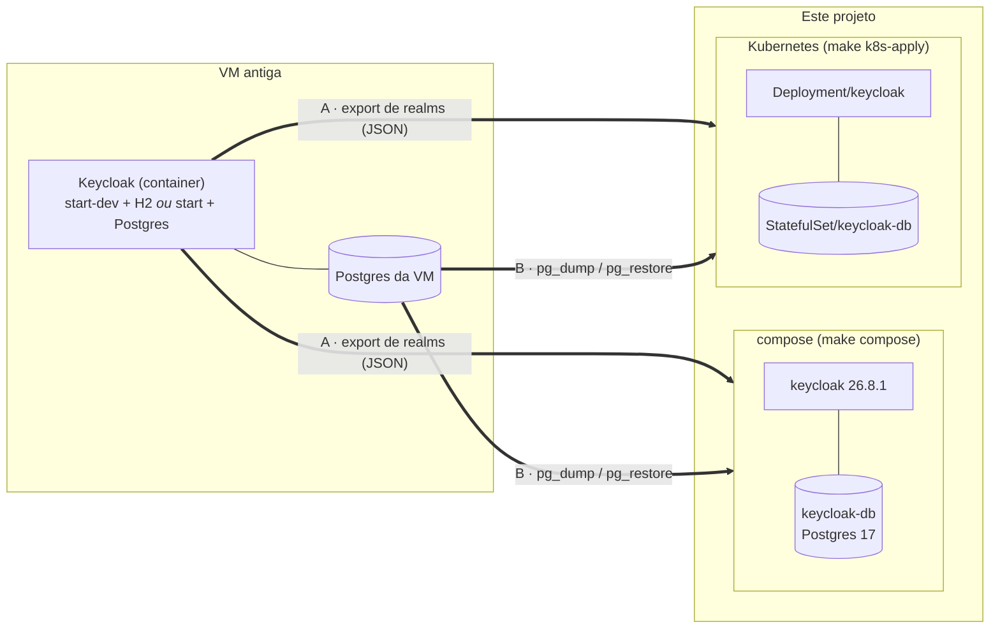

São dois caminhos:

| | A. Export de realms (JSON) | B. Dump do Postgres |
|---|---|---|
| Banco do Keycloak na VM | qualquer um (H2 do `start-dev`, Postgres, MySQL…) | só Postgres |
| O que vem | realms, usuários (com o hash da senha), roles, grupos, clients (com secrets), identity providers | **o banco inteiro**: tudo do A, mais o realm `master` (admins do console), sessões offline e eventos |
| Admin do console depois | o do `.env` / `secrets.env` deste projeto | o da VM (o `KC_ADMIN_*` daqui é ignorado) |
| Parada na VM | H2: o container fica parado ~1 min. Postgres: nenhuma | nenhuma |

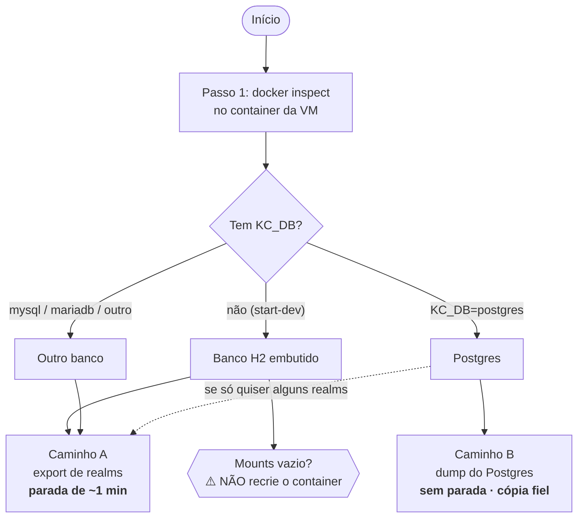

**Qual usar:** se a VM usa Postgres, use o **B** (cópia fiel). Se a VM roda em `start-dev` sem banco (H2, como no pseudo658), só o **A** funciona.

Nos dois casos, a versão do Keycloak da VM tem de ser **igual ou mais antiga** que a daqui (26.8.1). Na primeira subida, o Keycloak atualiza o schema e os realms sozinho (`Migrating older model to ...` no log; veja a figura do [B.2](#b2-restaurar-no-compose)). Voltar para uma versão mais antiga não funciona.

> Os arquivos exportados e o dump têm hashes de senha e secrets de clients. Não versione: guarde em `export/` ou use a extensão `.dump`, que estão no `.gitignore`. Apague depois da migração.

---

## 1. Na VM: descobrir onde o Keycloak guarda os dados

```bash
docker ps --format '{{.Names}}\t{{.Image}}'          # ache o container do Keycloak
KC=<nome-do-container-keycloak>

docker inspect $KC --format '{{.Config.Image}}'                           # versão
docker inspect $KC --format '{{json .Config.Cmd}}'                        # start ou start-dev
docker inspect $KC --format '{{range .Config.Env}}{{println .}}{{end}}' | grep '^KC_DB'
docker inspect $KC --format '{{json .Mounts}}'                            # volumes
```

**Exemplo 1: VM com H2.** O que olhar:

1. **Versão**: `26.1.5`, mais antiga que a daqui (26.8.1), então pode migrar.
2. **Comando**: `start-dev`.
3. **`KC_DB`**: o `grep` não acha nada, então não há banco externo: é o H2 embutido.
4. **Mounts**: `[]`, ou seja, **sem volume**. Os dados só existem dentro do container.

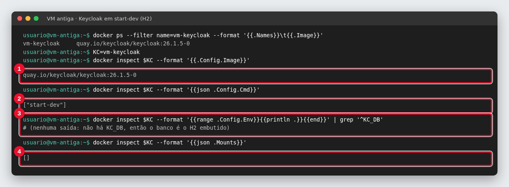

**Exemplo 2: VM com Postgres.** O que olhar:

1. **Comando**: `start`.
2. **`KC_DB=postgres`**.
3. **`KC_DB_URL`**: o host (`postgres`) e o banco (`keycloak`) que o caminho B vai usar.

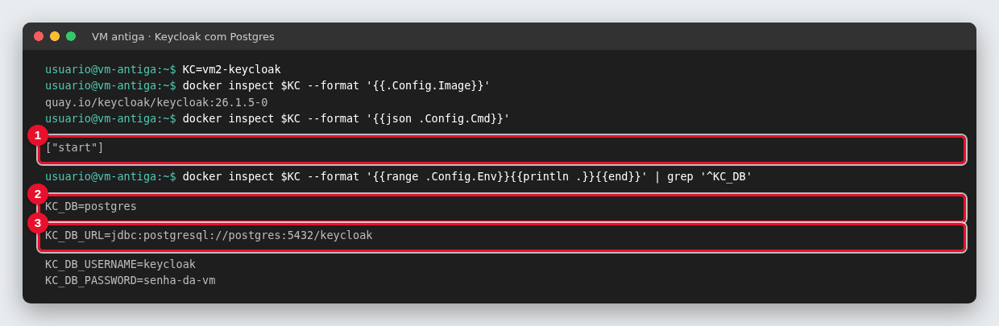

| O que aparece | Banco | Caminho |
|---|---|---|
| sem `KC_DB` (normalmente com `start-dev`) | H2 em `/opt/keycloak/data/h2` | só o A |
| `KC_DB=postgres` + `KC_DB_URL=jdbc:postgresql://<host>:5432/<banco>` | Postgres | B (ou A) |
| `KC_DB=mysql` / `mariadb` / outro | outro | A |

> ⚠️ **H2 sem volume** (`Mounts` = `[]`, como no exemplo 1): os dados só existem dentro do container. **Não rode** `docker rm`, `docker compose down` nem `up --force-recreate` na VM antes de copiar, ou os realms se perdem.

Imagens `jboss/keycloak` (Keycloak 16 ou anterior, WildFly) usam outros comandos e não são cobertas aqui.

---

## Caminho A: export de realms

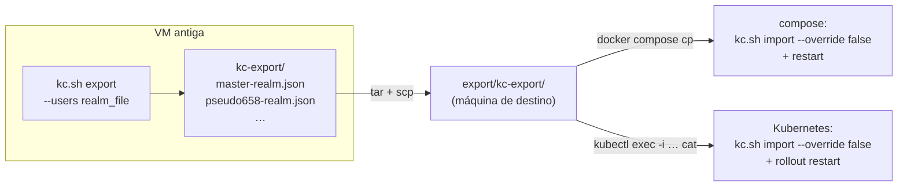

### A.1 Na VM

**Postgres/MySQL:** o export roda com o servidor no ar.

```bash
docker exec $KC /opt/keycloak/bin/kc.sh export --dir /tmp/kc-export --users realm_file --http-management-port=9001
docker cp $KC:/tmp/kc-export ./kc-export
```

O `--http-management-port=9001` evita disputar a porta 9000 com o servidor que está rodando. Em Keycloak anterior ao 25, remova essa opção (não existe).

Na figura:

1. O log mostra `Realm '<nome>' - data exported` para cada realm, inclusive o `master`, e termina em `Export finished successfully`.
2. Sai um `<realm>-realm.json` por realm.

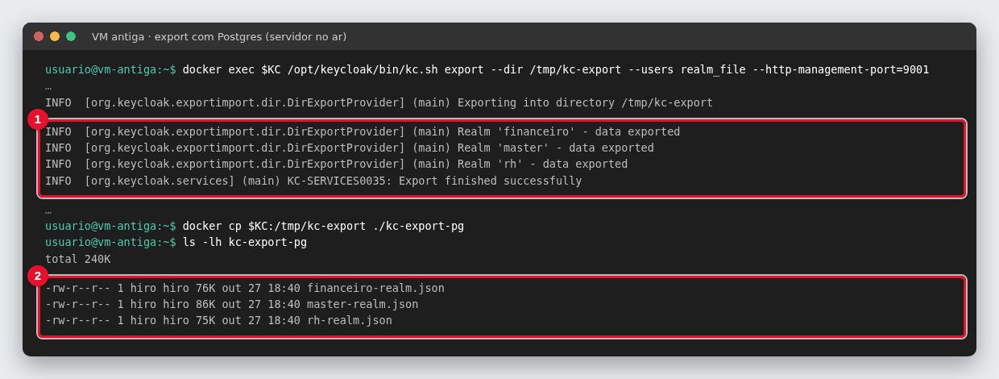

**H2 (`start-dev`):** o arquivo do H2 fica travado enquanto o servidor roda, e o export falha com `Database may be already in use`. Então pare o container, copie a pasta e exporte num container temporário com a mesma imagem:

```bash
IMG=$(docker inspect $KC --format '{{.Config.Image}}')
docker stop $KC
docker cp $KC:/opt/keycloak/data/h2 ./h2
docker run --name kc-export -u 0 -v "$PWD/h2:/opt/keycloak/data/h2" "$IMG" \
  export --dir /tmp/kc-export --users realm_file
docker cp kc-export:/tmp/kc-export ./kc-export
docker rm kc-export
docker start $KC
```

Na figura:

1. `docker stop`: **aqui começa a parada** na VM.
2. O export roda no container temporário `kc-export` e lista os realms exportados.
3. `docker start`: **fim da parada**. No ensaio, levou menos de 1 minuto.
4. Os JSONs gerados.

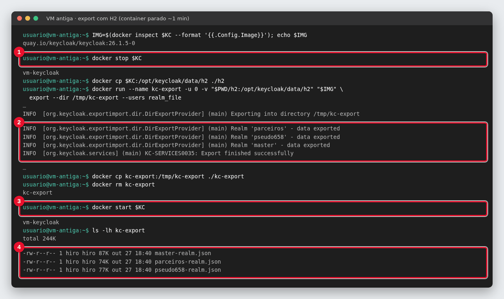

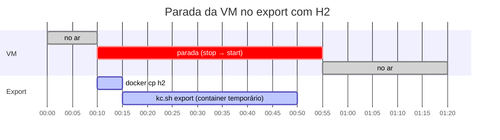

Nos dois casos, sai um `<realm>-realm.json` para cada realm, inclusive o `master`. Leve para a máquina de destino:

```bash
tar czf kc-export.tgz kc-export          # na VM
scp <vm>:kc-export.tgz .                 # na sua máquina
mkdir -p export && tar xzf kc-export.tgz -C export
```

### A.2 Importar no compose

Com o Keycloak daqui no ar (`make compose`):

```bash
docker compose cp export/kc-export keycloak:/tmp/kc-import
docker compose exec keycloak /opt/keycloak/bin/kc.sh import --dir /tmp/kc-import --override false --http-management-port=9001
docker compose restart keycloak
```

Atalho: `make importar-realms` (extrai o `kc-export.tgz` se a pasta não existir e roda os três comandos).

O `--override false` pula os realms que já existem: o `master` e o `automateflow` daqui ficam como estão. Para substituir um realm de mesmo nome pelo da VM, use `--override true`. O `restart` é necessário para o servidor que já estava rodando enxergar os realms novos.

Na figura:

1. `Realm 'master' already exists. Import skipped`: o `--override false` protegeu o `master` daqui.
2. `Realm '<nome>' imported`: os realms da VM entraram.
3. `restart`, para o servidor enxergar os realms novos.

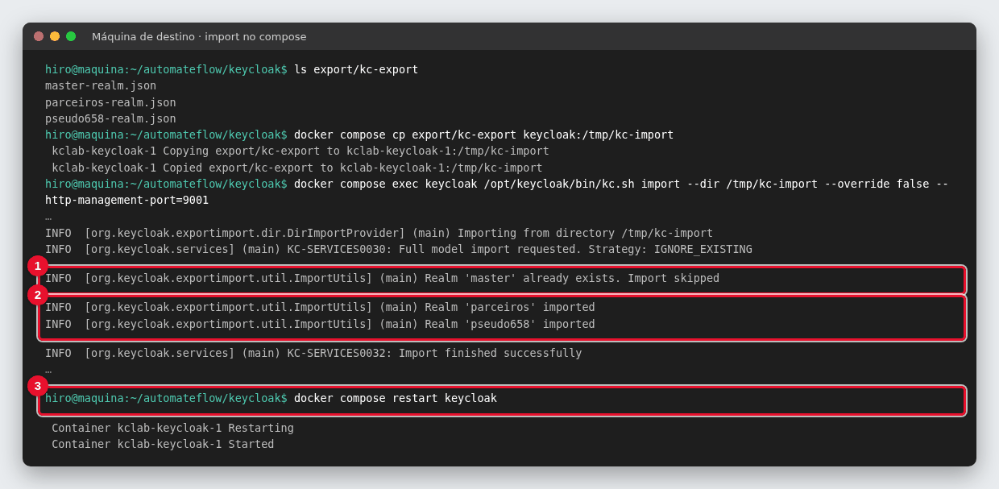

Depois do restart, os realms da VM (1, 2) aparecem no console ao lado do `automateflow` e do `master` daqui:

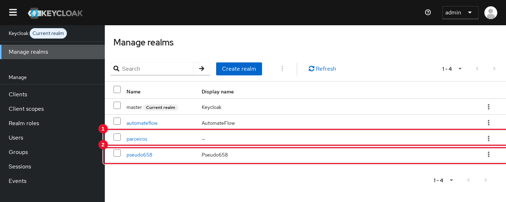

### A.3 Importar no Kubernetes

A imagem do Keycloak não tem `tar`, então o `kubectl cp` não funciona com ela. Envie um arquivo por vez com `cat`:

```bash
POD=$(kubectl -n keycloak get pod -l application=keycloak -o name | head -1)
kubectl -n keycloak exec $POD -- mkdir -p /tmp/kc-import
for f in export/kc-export/*.json; do
  case "$f" in */master-*) continue ;; esac
  kubectl -n keycloak exec -i $POD -- sh -c "cat > /tmp/kc-import/$(basename "$f")" < "$f"
done
kubectl -n keycloak exec $POD -- /opt/keycloak/bin/kc.sh import --dir /tmp/kc-import --override false --http-management-port=9001
kubectl -n keycloak rollout restart deploy/keycloak
```

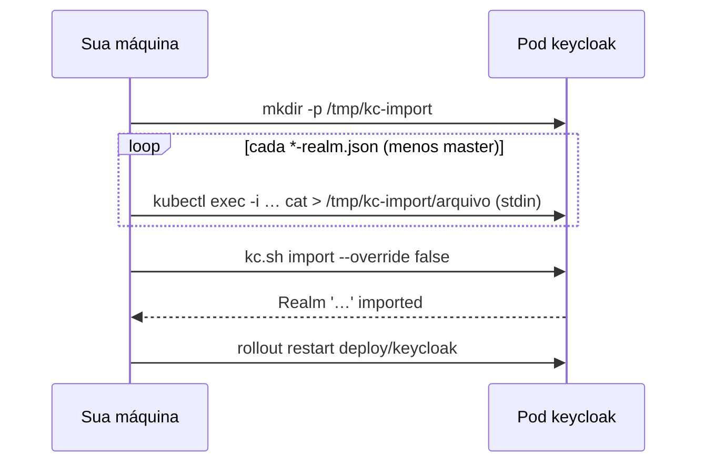

Atalho: `make k8s-importar-realms`.

A saída do `kc.sh import` é a mesma da figura do A.2. O `master` é pulado já no laço, então nem aparece no log.

---

## Caminho B: dump do Postgres

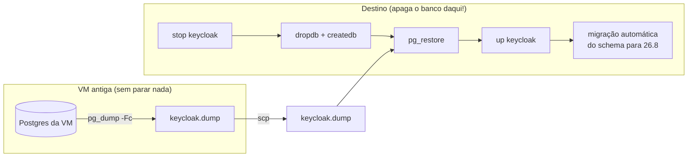

### B.1 Na VM

Pegue o host, o banco e o usuário no `KC_DB_URL` e no `KC_DB_USERNAME` do passo 1. Por exemplo, `jdbc:postgresql://postgres:5432/keycloak` significa container `postgres` e banco `keycloak`.

```bash
PG=<container-do-postgres>
docker exec $PG pg_dump -U <usuario> -d <banco> -Fc --no-owner --no-acl > keycloak.dump
scp <vm>:keycloak.dump .                 # na sua máquina
```

Na figura:

1. O `KC_DB_URL` e o `KC_DB_USERNAME` dão o banco (`keycloak`) e o usuário (`keycloak`).
2. O `pg_dump` roda com tudo no ar e não imprime nada quando dá certo.
3. O dump gerado: 222 KB para 3 realms.

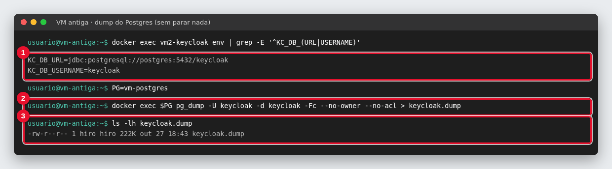

O `pg_dump` tira um retrato consistente mesmo com o Keycloak no ar, então não é preciso parar nada.

- Se a VM usa um schema diferente de `public` (`KC_DB_SCHEMA`), acrescente `-n <schema>` ao `pg_dump` e use o mesmo `KC_DB_SCHEMA` aqui.
- O Postgres daqui é o 17. Um dump de Postgres 18 ou mais novo pode não restaurar. Nesse caso, gere o dump com um `pg_dump` 17 (`docker run --rm postgres:17-alpine pg_dump -h <host> ...`).

### B.2 Restaurar no compose

> ⚠️ **Isto apaga o banco atual do Keycloak daqui.**

```bash
docker compose stop keycloak
docker compose up -d --wait keycloak-db
docker compose exec -T keycloak-db sh -c 'dropdb -U "$POSTGRES_USER" --if-exists "$POSTGRES_DB" && createdb -U "$POSTGRES_USER" "$POSTGRES_DB"'
docker compose exec -T keycloak-db sh -c 'pg_restore -U "$POSTGRES_USER" -d "$POSTGRES_DB" --no-owner --no-acl' < keycloak.dump
docker compose up -d keycloak
make logs                                # acompanhe a migração do schema
```

Atalho: `make restaurar-dump` (pede para digitar `apagar` antes).

Na figura:

1. `dropdb` + `createdb`: **o banco daqui é apagado** e recriado vazio.
2. `pg_restore` carrega o dump da VM. Sem erro, ele não imprime nada.
3. Na subida, o Keycloak 26.8.1 percebe o schema antigo: `Updating database`.
4. `Migrating older model to …`: o Keycloak atualiza os realms versão por versão (26.2 → 26.3 → … → 26.8).
5. `Realm 'automateflow' imported`: como esse realm não estava no dump, o `--import-realm` o criou a partir de `realm/automateflow-realm.json`.

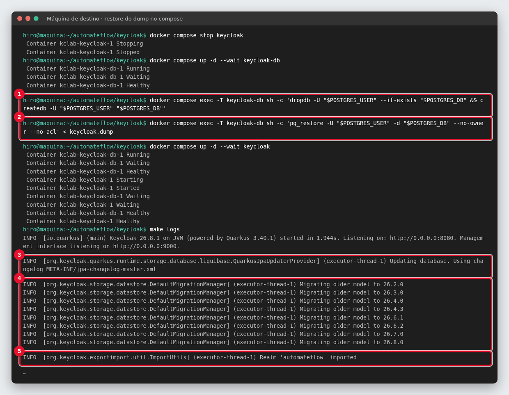

O console passa a mostrar o `master` **da VM** e os realms dela (1, 2), mais o `automateflow`:

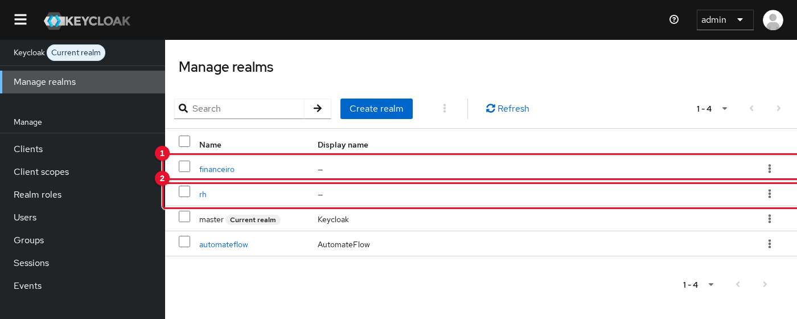

### B.3 Restaurar no Kubernetes

> ⚠️ **Isto apaga o banco atual do Keycloak no cluster.** O Keycloak precisa estar com 0 réplicas, porque o `dropdb` falha com conexões abertas.

```bash
kubectl -n keycloak scale deploy/keycloak --replicas=0
kubectl -n keycloak exec -i keycloak-db-0 -- sh -c 'dropdb -U "$POSTGRES_USER" --if-exists "$POSTGRES_DB" && createdb -U "$POSTGRES_USER" "$POSTGRES_DB"'
kubectl -n keycloak exec -i keycloak-db-0 -- sh -c 'pg_restore -U "$POSTGRES_USER" -d "$POSTGRES_DB" --no-owner --no-acl' < keycloak.dump
kubectl -n keycloak scale deploy/keycloak --replicas=1
kubectl -n keycloak logs -f deploy/keycloak
```

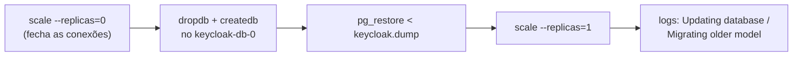

Atalho: `make k8s-restaurar-dump` (pede confirmação e espera o pod antigo sair antes do `dropdb`).

O log do pod mostra as mesmas linhas da figura do B.2 (itens 3 a 5).

Depois do B, o console é acessado com o **admin da VM**. O `realm/automateflow-realm.json` daqui ainda é importado no boot, se esse realm não estiver no dump.

---

## 2. Depois de migrar

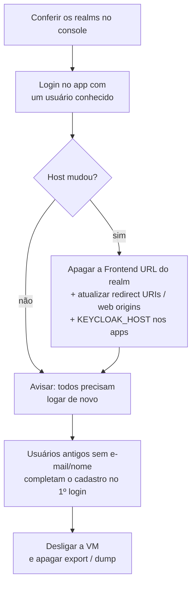

### Confira

Em `https://<host>/admin`, veja se todos os realms aparecem (figuras do [A.2](#a2-importar-no-compose) e do [B.2](#b2-restaurar-no-compose)). Depois, faça login no app com um usuário conhecido. **A senha é a mesma da VM**, porque o hash veio junto. Abaixo, a usuária `maria.souza` entrando no destino com a senha que tinha na VM:

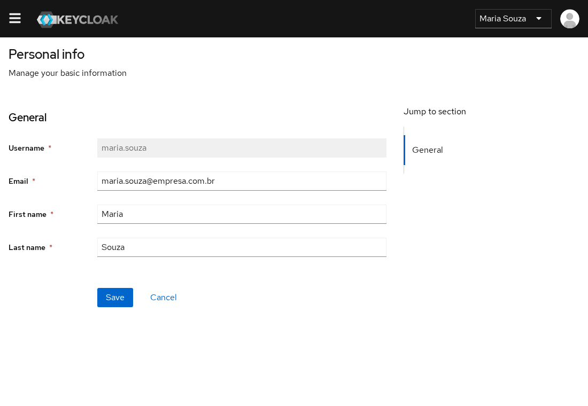

### Host novo

Se o endereço mudou, há três lugares para ajustar. Os itens a e b são feitos pela tela **Migração da VM → Host novo** do assistente, um realm por vez.

**a) Frontend URL do realm.** Se a VM tinha uma (1), o realm continua mandando o navegador para o host antigo. Apague o campo em *Realm settings → General → Frontend URL* e salve.

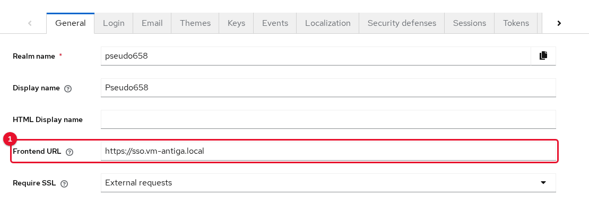

O sintoma aparece no endpoint de descoberta do realm, que é o que os apps leem:

1. **Antes**: `issuer` e `authorization_endpoint` apontam para `sso.vm-antiga.local`, e o login quebra.
2. **Depois de apagar o campo**: apontam para o host novo.

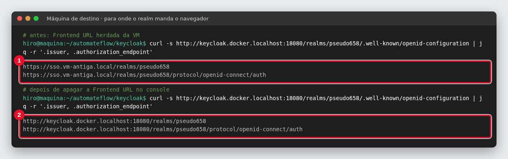

**b) Clients.** Em *Clients → \<client\> → Settings*, troque os endereços do host antigo em **Valid redirect URIs** (1), **Valid post logout redirect URIs** (2) e **Web origins** (3):

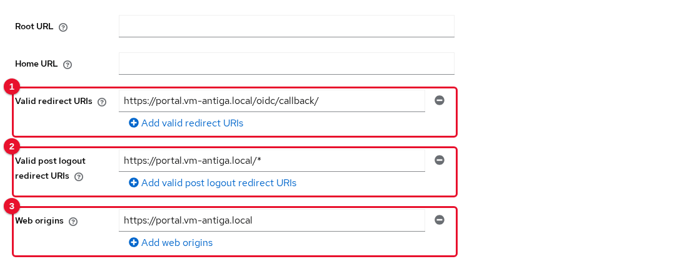

**c) Apps.** Ajuste `KEYCLOAK_HOST`, `KEYCLOAK_INTERNAL_URL` e `KEYCLOAK_REALM`.

### Sessões

Com outro host, o `iss` dos tokens muda (figura acima), então todo mundo precisa logar de novo. No caminho A, as sessões nem são levadas.

### Usuários sem e-mail ou nome

No Keycloak 24 ou mais novo, o perfil de usuário exige e-mail, nome e sobrenome. Usuários antigos sem esses campos, como o `joao.antigo` do ensaio, veem no primeiro login uma tela para completar **Email** (1), **First name** (2) e **Last name** (3):

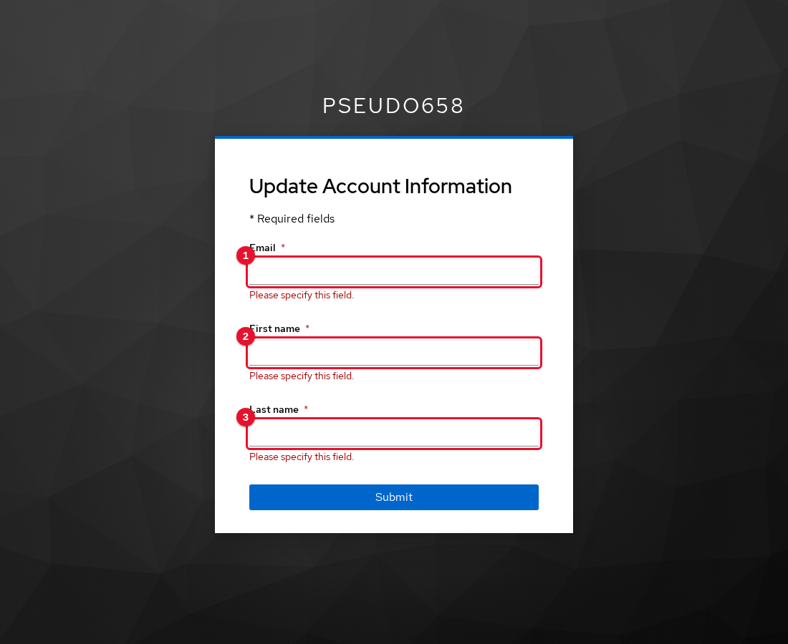

Fluxos sem tela (password grant) falham com `Account is not fully set up` até o cadastro ser completado. Para evitar isso, preencha os campos pelo console (*Users → \<usuário\> → Details*) antes de liberar o acesso. A tela **Migração da VM** do assistente lista esses usuários.

### Só desligue a VM depois de validar

Depois, apague os arquivos exportados (`export/`, `kc-export.tgz`) e o dump (`keycloak.dump`), aqui e na VM.
