# Realm, SSO via SAML e grupos

Este guia mostra, passo a passo no console do Keycloak 26, como:

1. [criar um realm](#1-criando-um-realm);
2. [cadastrar um provedor SAML](#2-cadastrando-um-provedor-saml-sso-corporativo) (Entra ID, Google Workspace, Okta, ADFS…), para que os usuários entrem com a conta corporativa;
3. [criar grupos e dar permissões a eles](#3-criando-grupos-e-dando-permissões);
4. [configurar os grupos no SSO](#4-como-configurar-os-grupos-no-sso) para que eles cheguem ao Keycloak.

As telas foram capturadas no Keycloak 26.8.1, com o realm deste repositório. Os números em vermelho nas figuras correspondem aos itens numerados do texto. O "SSO corporativo" das figuras é um segundo realm do Keycloak (`corp-sso`), que faz o papel do Entra ID ou do Google. O fluxo inteiro foi testado assim: login, importação dos grupos e remoção de grupo com `Force`.

O console fica em `https://<KC_HOST>/admin`. Entre com o admin do realm **master** (`KC_ADMIN_USER`).

> **Atalho:** o assistente (`https://<ASSISTENTE_HOST>`, veja o [README](README.md)) faz pelo Keycloak tudo o que este guia manda clicar, com "Simular" antes de "Aplicar":
>
> | Seção do guia | Tela do assistente |
> |---|---|
> | 1. Criando um realm (1.1–1.7) e 3.1 Roles | **1 · Realm e apps** |
> | 3.2 Grupos | **2 · Grupos e roles** |
> | 2. Provedor SAML (URLs do 2.1, cadastro do 2.3, mappers do 2.4, login direto do 2.6) | **3 · SSO corporativo** |
> | 4.4 Mapeando no Keycloak | **4 · Grupos do SSO** |
> | 3.3, 4.5 Conferindo, 1.8 `.env` dos apps e "Versionando" | **5 · Conferir** |
>
> O que acontece **no SSO** (seções 2.2 e 4.1–4.3) continua sendo feito no portal do Entra, do Google ou do Okta; a tela 3 mostra as URLs e o roteiro para o time do SSO. Este guia segue como referência do que cada tela faz e por quê.

---

## Visão geral

### Quem fala com quem

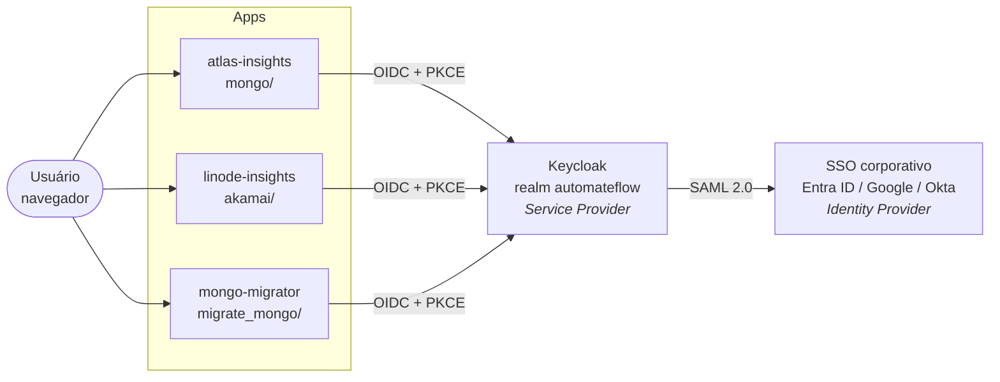

Os apps só falam **OIDC** com o Keycloak e não sabem que existe SAML. O Keycloak traduz: recebe a asserção SAML do SSO e entrega um token OIDC para o app.

### O login, passo a passo

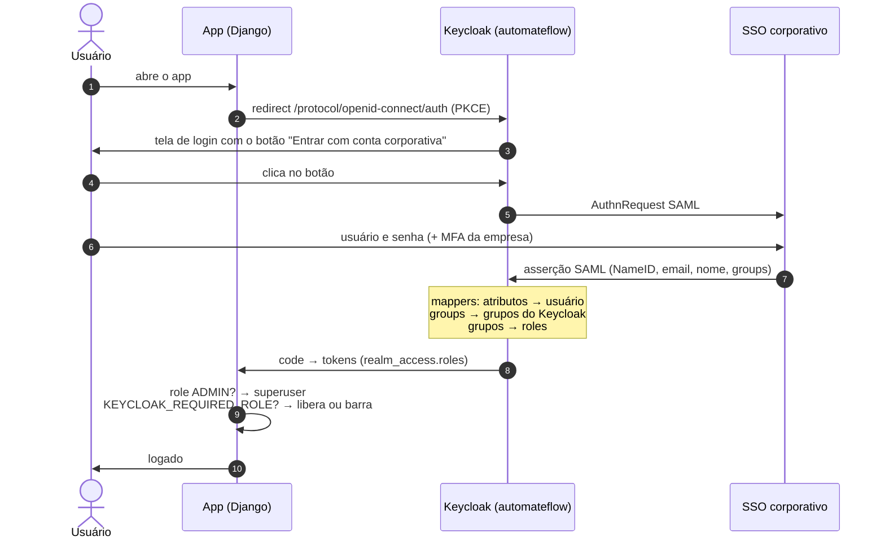

### Como as permissões chegam ao app

Os apps (`mongo/`, `akamai/`, `migrate_mongo/`) **não leem grupos**. No login, o `sso.py` de cada app lê só as **roles de realm** do access token (`realm_access.roles`):

| Role | Efeito no app | Variável |
|---|---|---|
| `ADMIN` | o usuário vira `is_staff` + `is_superuser` | `KEYCLOAK_ADMIN_ROLE` (padrão `ADMIN`) |
| role exigida | quem não tem a role é barrado no login. Vazio = qualquer usuário do realm entra | `KEYCLOAK_REQUIRED_ROLE` (padrão vazio) |

Um grupo que tem uma role passa essa role para os membros, e ela aparece no token. A cadeia completa:

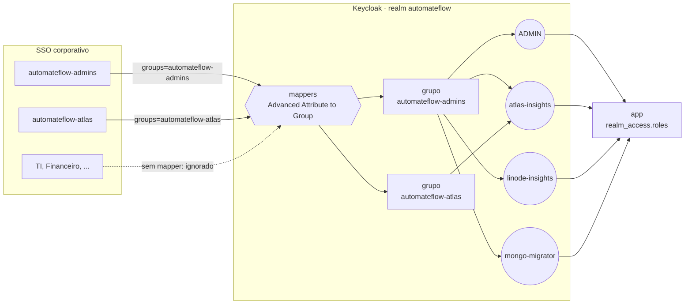

Cada lado cuida de uma coisa:

- **No SSO**, você controla *quem* está em cada grupo.
- **No Keycloak**, você controla *o que* cada grupo pode fazer (as roles).
- **No app**, você só escolhe qual role vira admin (`KEYCLOAK_ADMIN_ROLE`) e qual role é obrigatória (`KEYCLOAK_REQUIRED_ROLE`).

> As roles são recalculadas a cada login. Depois de mudar um grupo, o usuário precisa sair e entrar de novo.

---

## 1. Criando um realm

> O realm `automateflow` já é criado no primeiro boot a partir de [realm/automateflow-realm.json](realm/automateflow-realm.json). Só crie outro realm para um ambiente ou cliente separado (ex.: `automateflow-hml`).

### 1.1 Criar

No menu lateral, clique em **Manage realms** (1) e depois em **Create realm** (2).

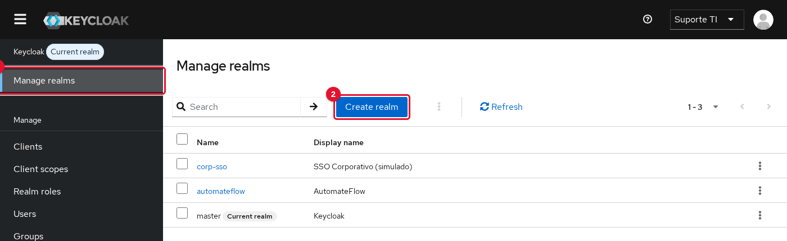

Na janela **Create realm**:

1. **Resource file**: opcional. Arraste um JSON de realm (ex.: um `realm/*.json` com os `${...}` já substituídos) para criar tudo de uma vez.
2. **Realm name**: minúsculas e hífen, sem espaço. Ele entra nas URLs (`/realms/<nome>`) e no `KEYCLOAK_REALM` dos apps.
3. **Enabled**: ligado.
4. **Create**.

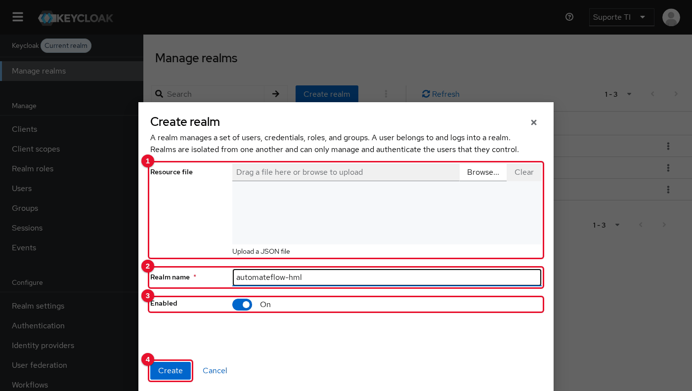

Depois de criado, o realm novo aparece como **Current realm** no topo do menu, e tudo o que você fizer a seguir vale para ele.

### 1.2 Configurações gerais

Em **Realm settings → General**:

1. **Realm settings** no menu.
2. **Display name**: nome que aparece na tela de login.
3. **Require SSL**: `External requests`.

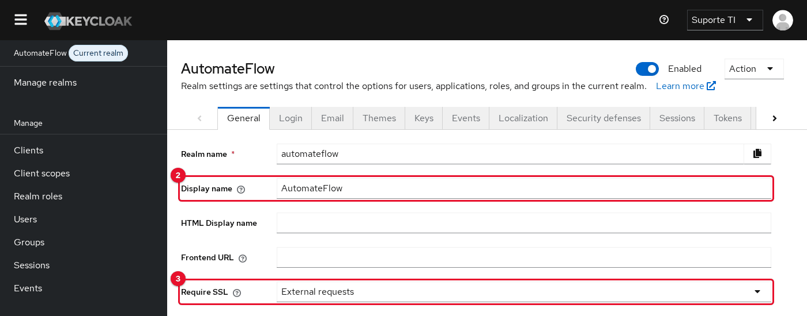

### 1.3 Tela de login

Na aba **Login**:

1. **User registration**: `Off`. Os usuários vêm do SSO ou são criados pelo admin.
2. **Forgot password**: `Off`. Com SSO, a senha é trocada no SSO, não aqui.
3. **Login with email**: `On`.

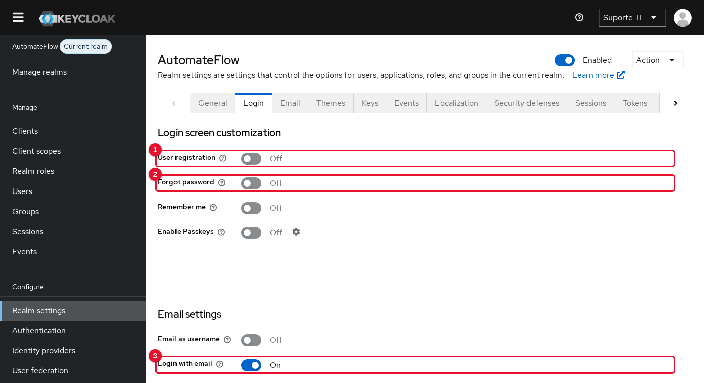

### 1.4 Idioma

Em **Localization → Locales**:

1. **Internationalization**: `Enabled`.
2. **Supported locales**: `Brazilian Portuguese` e `English`.
3. **Default locale**: `Brazilian Portuguese`.

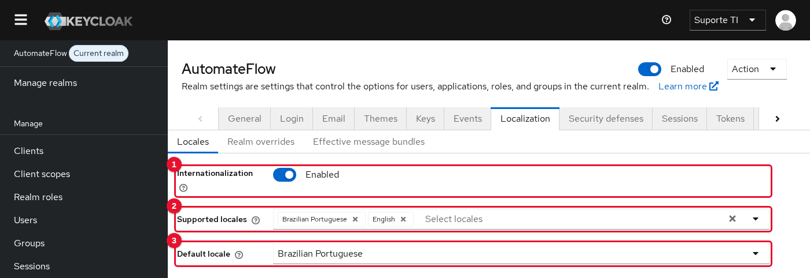

### 1.5 Proteção contra força bruta

Em **Security defenses**:

1. Aba **Brute force detection**.
2. **Brute Force Mode**: `Lockout temporarily`.

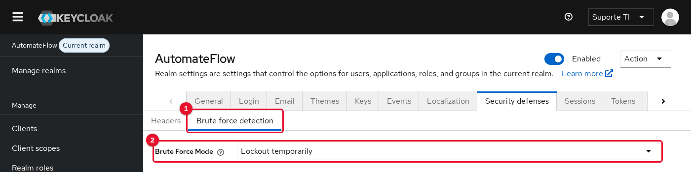

### 1.6 Role de admin

Em **Realm roles → Create role**, crie a role `ADMIN` (detalhes na [seção 3.1](#31-roles)).

### 1.7 Clients dos apps

Em **Clients → Create client**, crie um client OIDC por app (`atlas-insights`, `linode-insights`, `mongo-migrator`). As figuras mostram o `atlas-insights` já criado.

Na aba **Settings**, em **General settings** e **Access settings**:

1. **Client ID**: o mesmo valor do `KEYCLOAK_CLIENT_ID` do app.
2. **Valid redirect URIs**: `<URL do app>/oidc/callback/`.
3. **Valid post logout redirect URIs**: `<URL do app>/*`.
4. **Web origins**: `<URL do app>`.

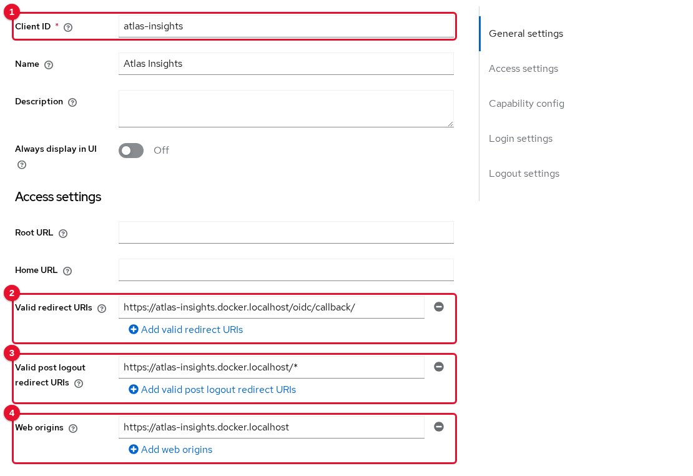

Mais abaixo, em **Capability config**:

1. **Client authentication**: `Off`. O client é público; o app não guarda secret.
2. **Authentication flow**: só **Standard flow**.
3. **Require PKCE**: `On`.
4. **PKCE Method**: `S256`.

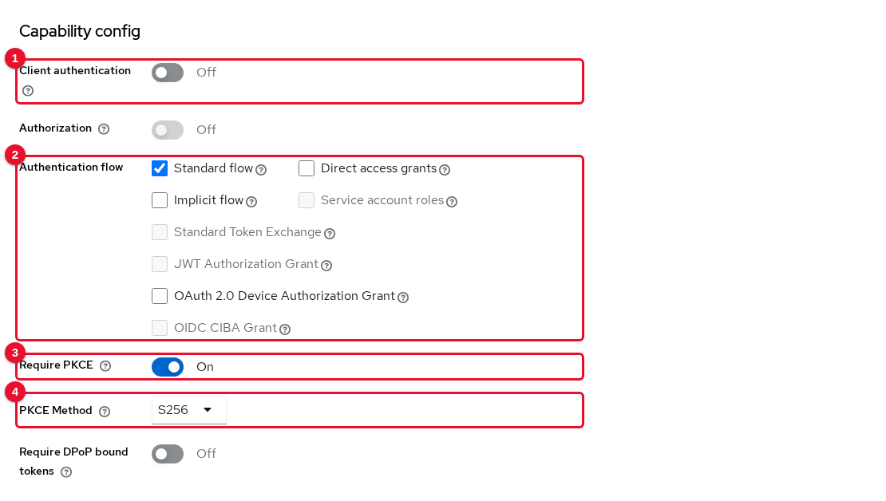

### 1.8 Apontar os apps para o realm

No `.env` de cada app:

```bash
KEYCLOAK_REALM=<novo-realm>
```

### Alternativa: criar o realm pelo JSON (versionado)

Copie `realm/automateflow-realm.json` para `realm/<novo-realm>.json`, troque `"realm"` e o que mais precisar, e reinicie o Keycloak (`docker compose restart keycloak`). O `--import-realm` cria os realms de `realm/` que **ainda não existem** no banco, sem tocar nos que já existem. No Kubernetes, o arquivo também precisa entrar no ConfigMap do [kustomization.yaml](kustomization.yaml).

---

## 2. Cadastrando um provedor SAML (SSO corporativo)

Nesta integração, o Keycloak é o **Service Provider (SP)** e o SSO da empresa é o **Identity Provider (IdP)**. O cadastro acontece nos dois lados, nesta ordem:

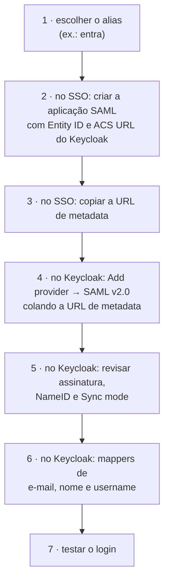

### 2.1 Dados que o SSO vai pedir

Escolha antes o **alias** do provedor (ex.: `entra`). Ele entra nas URLs e **não pode ser trocado depois**.

| Campo no SSO | Valor |
|---|---|
| Entity ID / Identifier / Audience | `https://<KC_HOST>/realms/<realm>` |
| ACS URL / Reply URL / Single sign-on URL | `https://<KC_HOST>/realms/<realm>/broker/<alias>/endpoint` |
| Logout URL (opcional) | `https://<KC_HOST>/realms/<realm>/broker/<alias>/endpoint` |
| Metadata do SP (se o SSO aceitar importar) | `https://<KC_HOST>/realms/<realm>/broker/<alias>/endpoint/descriptor` |

O Keycloak mostra essas URLs na tela de cadastro do provedor (figura da [seção 2.3](#23-cadastrar-o-provedor-no-keycloak), itens 1 e 4).

> O SSO só precisa conseguir redirecionar o **navegador** para o `KC_HOST`; ele não acessa o Keycloak pela rede. Com `keycloak.docker.localhost` dá para testar na sua máquina.

### 2.2 Criar a aplicação SAML no SSO

**Microsoft Entra ID**: *Enterprise applications → New application → Create your own application → Integrate any other application (non-gallery)*.

1. Em **Single sign-on → SAML → Basic SAML Configuration**: preencha *Identifier (Entity ID)* e *Reply URL* com os valores da tabela acima.
2. Em **Attributes & Claims**: mantenha `emailaddress`, `givenname`, `surname` e o *Unique User Identifier* (`user.userprincipalname`). O claim de grupos é configurado na [seção 4](#4-como-configurar-os-grupos-no-sso).
3. Em **SAML Certificates**: copie a **App Federation Metadata Url**.
4. Em **Users and groups**: atribua os grupos que podem usar o app.

**Google Workspace**: *Admin console → Apps → Web and mobile apps → Add app → Add custom SAML app*.

1. Na etapa *Google Identity Provider details*, baixe o **IdP metadata**.
2. Em *Service provider details*: preencha *ACS URL* e *Entity ID*, com *Name ID format* `EMAIL` e *Name ID* `Basic Information > Primary email`.
3. Em *Attribute mapping*: mapeie *First name* → `firstName`, *Last name* → `lastName` e *Primary email* → `email`.
4. Em *User access*: ative o app para as unidades organizacionais ou grupos certos.

**Okta / ADFS / outros**: o processo é o mesmo. Use os valores da tabela, mande `email`, nome e sobrenome como atributos e pegue a URL (ou o XML) de metadata.

### 2.3 Cadastrar o provedor no Keycloak

No realm, vá em **Identity providers** (1), abra **Add provider** (2) e escolha **SAML v2.0** (3):

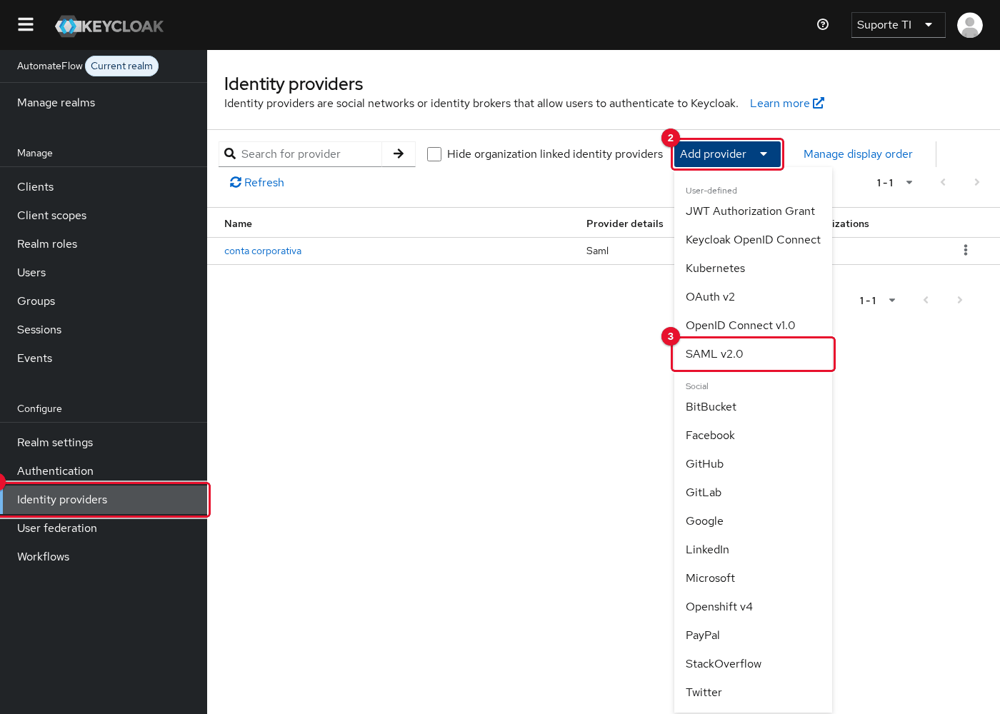

Na tela **Add SAML provider**:

1. **Redirect URI**: gerada a partir do alias. É a *ACS / Reply URL* que vai no SSO.
2. **Alias**: o mesmo escolhido na seção 2.1. No exemplo, `sso-empresa`.
3. **Display name**: o Keycloak põe "Entrar com" na frente. Escreva só o final, ex.: `conta corporativa` vira **"Entrar com conta corporativa"**.
4. **Service provider entity ID**: deixe o padrão (`https://<KC_HOST>/realms/<realm>`). É o *Entity ID* que vai no SSO.
5. **Use entity descriptor**: `On`.
6. **SAML entity descriptor**: a URL de metadata do SSO (no Entra, a *App Federation Metadata Url*). O ✔ verde indica que o Keycloak conseguiu baixá-la. Se só tiver o XML, desligue o item 5 e preencha a *Single Sign-On service URL* e o certificado à mão.
7. **Add**.

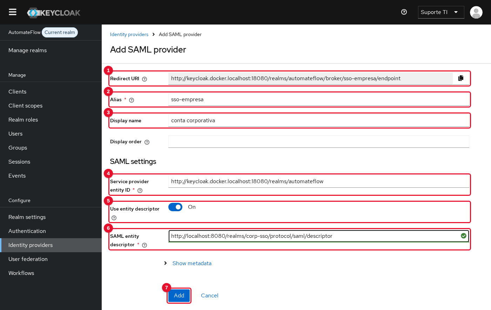

Depois de criado, o provedor abre na aba **Settings**. Em **General settings** ficam as mesmas informações da criação (1–3). Em **Endpoints** (4) está o link do *SAML 2.0 Service Provider Metadata*, que dá para importar direto no SSO.

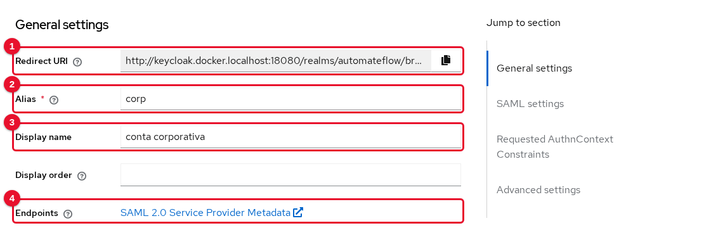

Em **SAML settings**, confira:

1. **Service provider entity ID**: o Entity ID do Keycloak.
2. **Identity provider entity ID**: veio do metadata do SSO.
3. **Single Sign-On service URL**: veio do metadata do SSO.
4. **NameID policy format**: `Email` (o Entra e o Google mandam o e-mail ou o UPN no NameID). Use `Persistent` se o SSO mandar um ID fixo.
5. **Principal type**: `Subject NameID`.

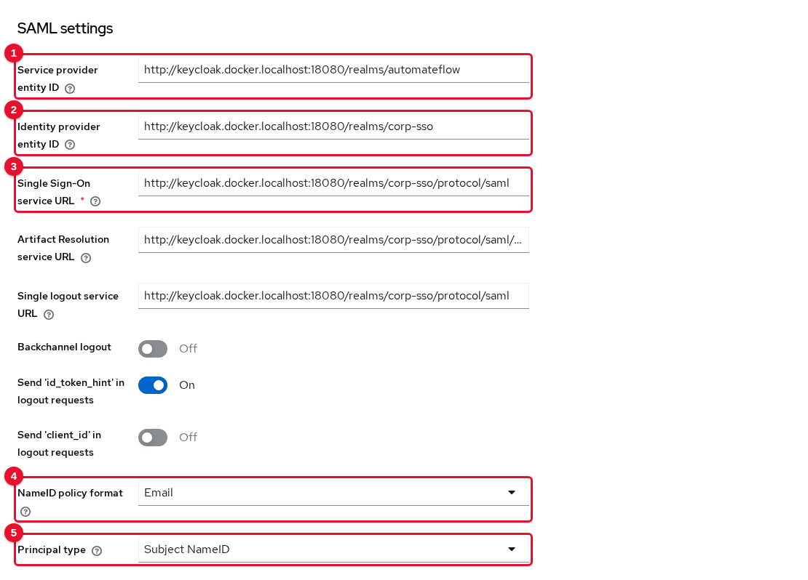

Mais abaixo, a parte de assinaturas:

1. **Want AuthnRequests signed**: `On`. Se o SSO pedir, cadastre nele o certificado do Keycloak (está no metadata do SP).
2. **Want Assertions signed**: `On`.
3. **Validate Signatures**: `On`. O certificado de validação (*Validating X509 certificates*) veio do metadata.

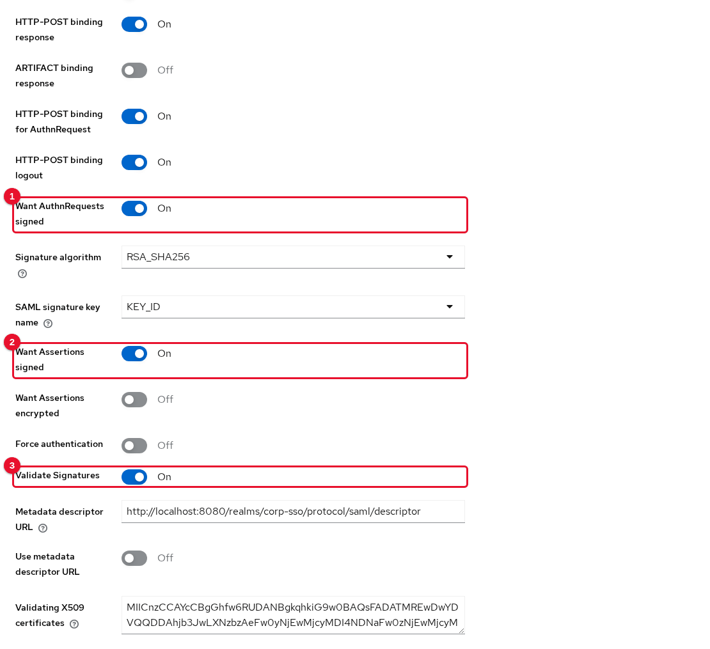

E em **Advanced settings**:

1. **Trust Email**: `On`. O e-mail já vem verificado pelo SSO.
2. **First login flow override**: `first broker login` (padrão).
3. **Sync mode**: `Force`, para que nome, e-mail e grupos sejam atualizados **a cada login**.

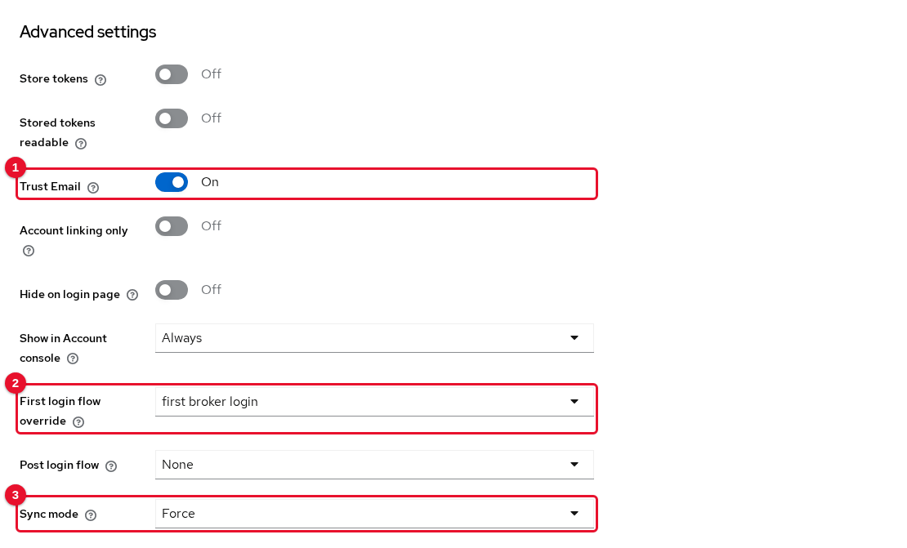

Clique em **Save** no rodapé.

### 2.4 Mappers de atributos

Na aba **Mappers** (1), use **Add mapper** (2) para criar um mapper para cada atributo que o SSO manda. A figura mostra a lista completa, já com os mappers de grupo da [seção 4](#4-como-configurar-os-grupos-no-sso):

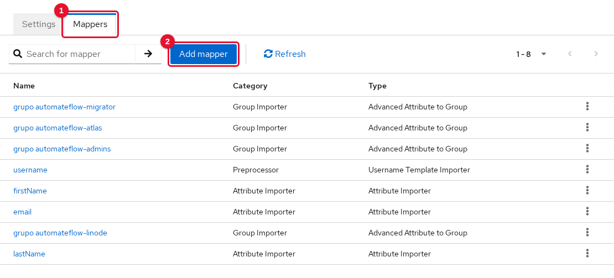

Os mappers de atributo (**Mapper type** `Attribute Importer`) copiam um atributo da asserção para o usuário:

1. **Sync mode override**: `Inherit` (usa o `Force` do provedor).
2. **Mapper type**: `Attribute Importer`.
3. **Attribute Name**: nome do atributo na asserção SAML.
4. **User Attribute Name**: o campo do usuário no Keycloak.

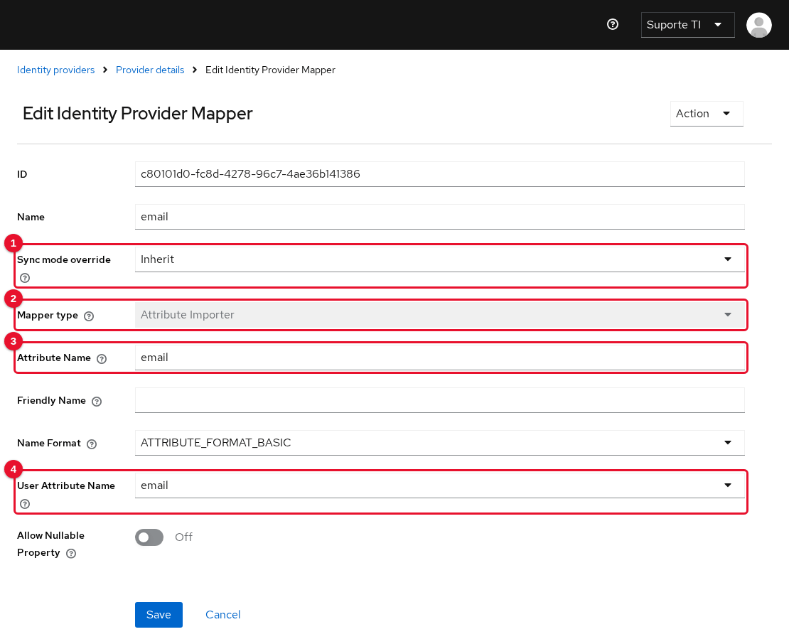

Crie um para cada linha:

| Name | Attribute Name (Entra ID) | Attribute Name (Google / Okta) | User Attribute Name |
|---|---|---|---|
| email | `http://schemas.xmlsoap.org/ws/2005/05/identity/claims/emailaddress` | `email` | `email` |
| firstName | `http://schemas.xmlsoap.org/ws/2005/05/identity/claims/givenname` | `firstName` | `firstName` |
| lastName | `http://schemas.xmlsoap.org/ws/2005/05/identity/claims/surname` | `lastName` | `lastName` |

Por fim, o **username** do usuário, que vira o `preferred_username` e o username no Django:

1. **Mapper type**: `Username Template Importer`.
2. **Template**: `${ATTRIBUTE.email}` (Entra, com o mapper `email` acima) ou `${NAMEID}`.
3. **Target**: `LOCAL`.

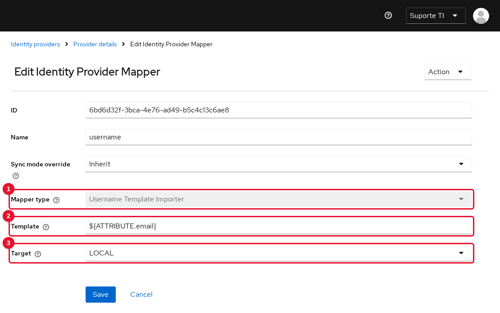

### 2.5 Testando o login

Abra um app (ou `https://<KC_HOST>/realms/<realm>/account`). A tela de login passa a ter o botão do SSO (1):

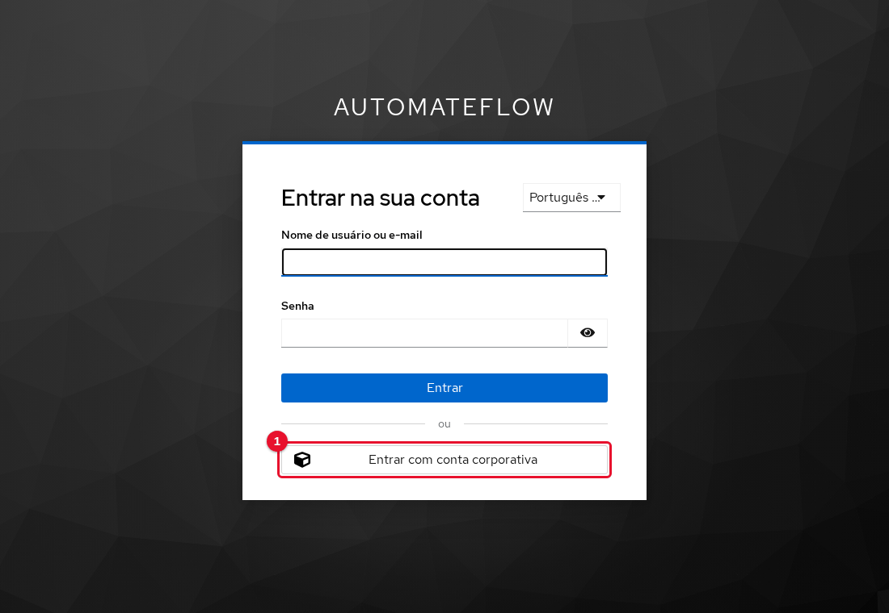

O botão leva para o login do SSO. Na figura, é o SSO simulado; na vida real, é a tela da Microsoft ou do Google:

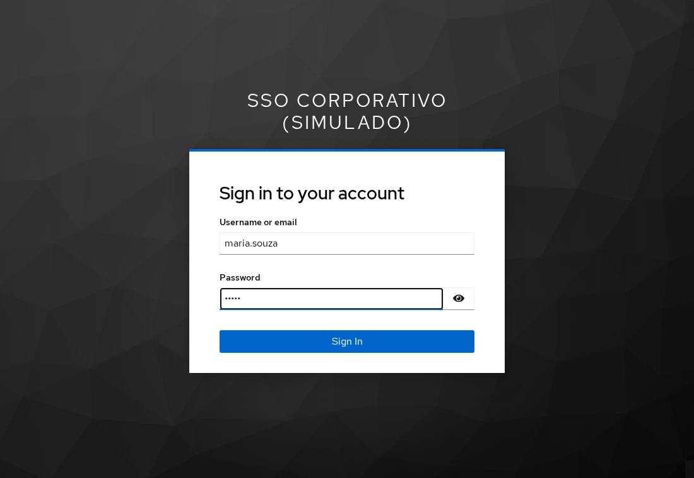

Depois do login, o usuário volta ao app já logado. No Keycloak, em **Users → \<usuário\> → Identity provider links** (1), aparece o vínculo com o provedor (2):

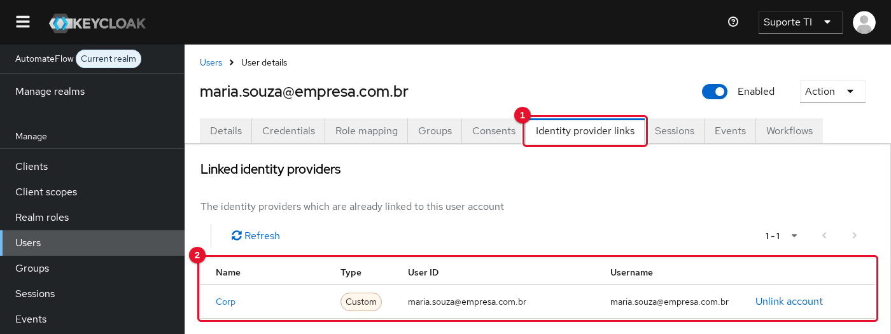

Se der erro, veja os logs (`make logs`). As causas mais comuns são:

| Erro | Causa |
|---|---|
| `Invalid signature` | o certificado do SSO mudou. Atualize o *Validating X509 certificates* (figura da seção 2.3) com o certificado novo do metadata |
| `Invalid destination` / `Invalid audience` | a Reply URL ou o Entity ID no SSO não batem com a tabela 2.1 |
| a tela pede para "vincular a conta" | já existe um usuário local com o mesmo e-mail. O *first broker login* pede a senha local uma vez para vincular |

### 2.6 Login direto pelo SSO (opcional)

Para pular a tela do Keycloak e mandar o usuário direto ao SSO, vá em **Authentication → browser**, na linha **Identity Provider Redirector** (1), e clique na engrenagem (2):

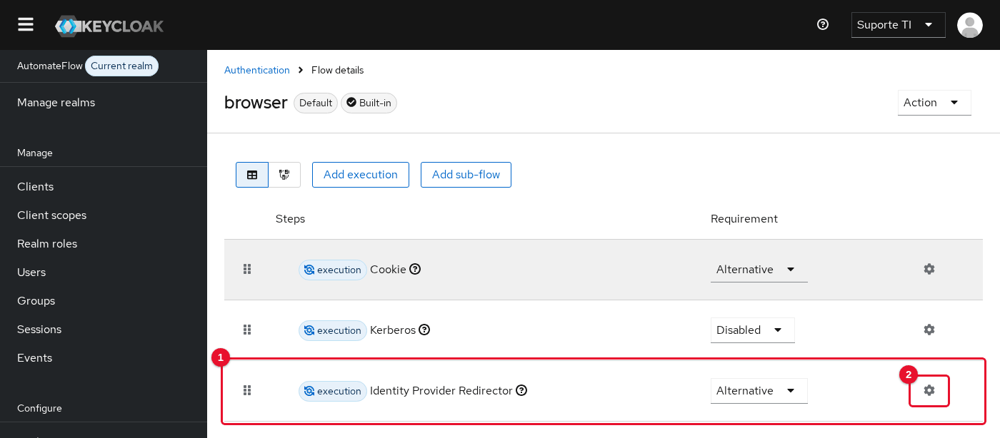

Na janela de configuração:

1. **Alias**: um nome qualquer para a configuração.
2. **Default Identity Provider**: o alias do provedor (ex.: `entra`).
3. **Save**.

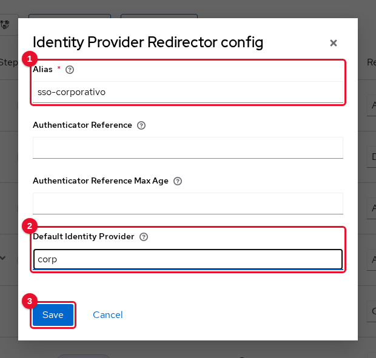

O admin local continua entrando pelo console do realm **master**, que não passa por esse fluxo.

---

## 3. Criando grupos e dando permissões

### 3.1 Roles

Os grupos só servem para os apps se tiverem roles. Em **Realm roles** (1), clique em **Create role** (2). Crie uma role de acesso por app (3–6):

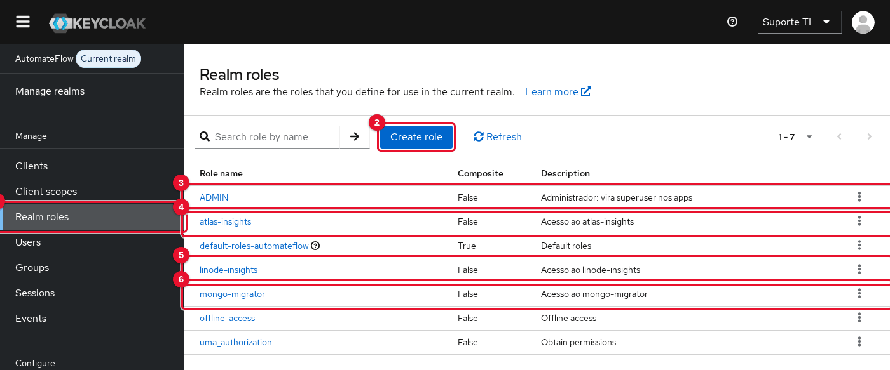

| Role | Uso |
|---|---|
| `ADMIN` | superuser em todos os apps (já vem no JSON do realm) |
| `atlas-insights` | acesso ao Atlas Insights (`mongo/`) |
| `linode-insights` | acesso ao Linode Insights (`akamai/`) |
| `mongo-migrator` | acesso ao Mongo Migrator (`migrate_mongo/`) |

Na tela **Create role**, preencha **Role name** (1) e **Description** (2) e clique em **Save** (3):

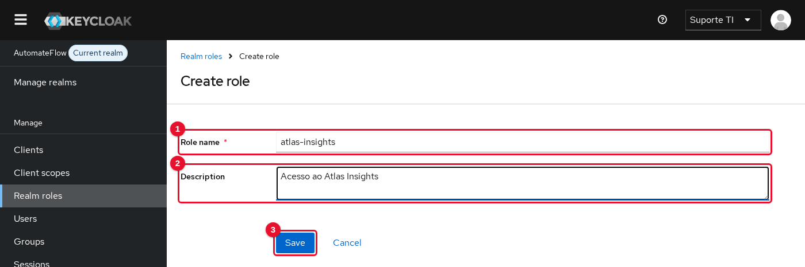

Depois, em cada app que deve ser restrito, coloque no `.env`:

```bash
KEYCLOAK_REQUIRED_ROLE=atlas-insights   # ou linode-insights / mongo-migrator
```

> ⚠️ Sem `KEYCLOAK_REQUIRED_ROLE`, **qualquer usuário que conseguir logar no realm entra no app**. Com SSO, isso pode ser a empresa inteira.
>
> A role exigida vale também para o admin: o grupo de admins precisa ter as roles de acesso (veja 3.2).

### 3.2 Grupos

Em **Groups** (1), clique em **Create group** (2):

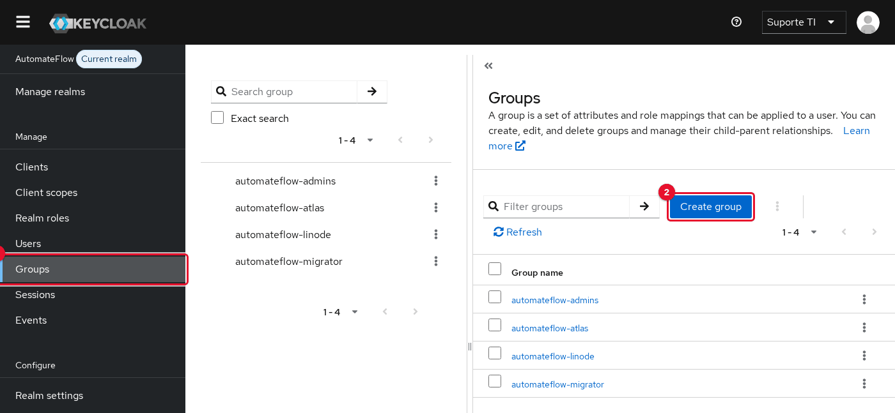

Dê ao grupo um **Name** (1) **igual ao nome do grupo no SSO**, o que facilita a auditoria e o mapper, e clique em **Create** (2):

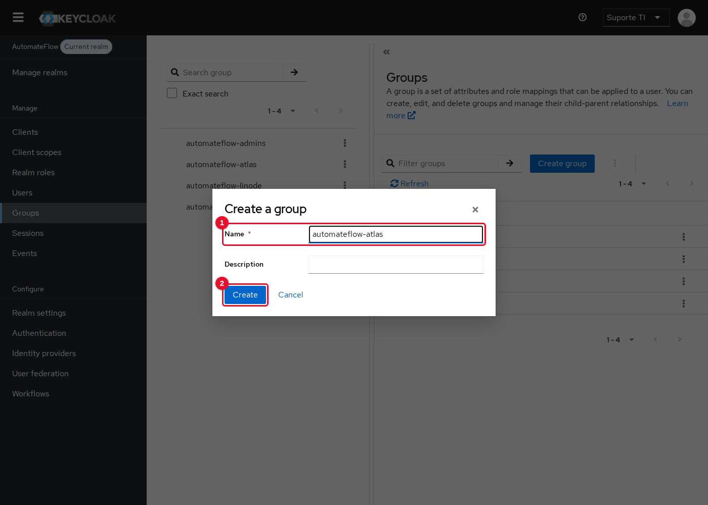

Abra o grupo e vá na aba **Role mapping** (1). Clique em **Assign role** (2) e escolha **Realm roles**. A lista (3) mostra as roles que o grupo já tem. Abaixo, o grupo `automateflow-admins` com as quatro roles:

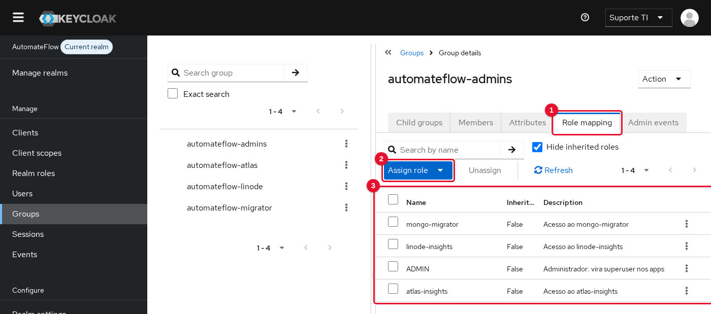

Na janela de roles, marque as roles do grupo (1, 2) e clique em **Assign** (3):

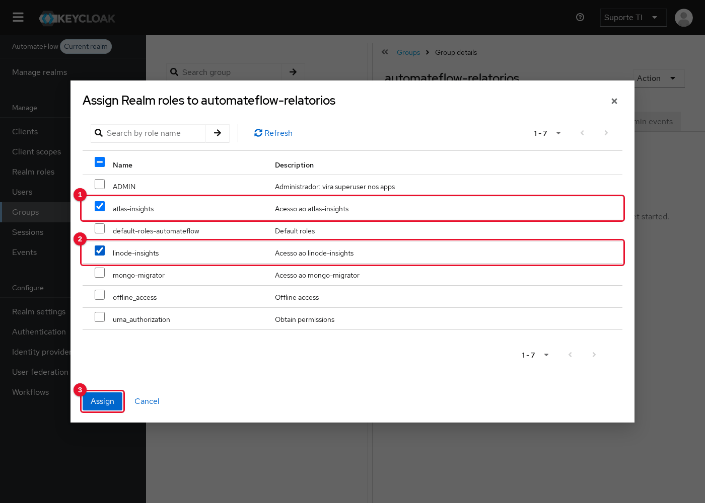

Estrutura sugerida:

| Grupo | Roles de realm |
|---|---|
| `automateflow-admins` | `ADMIN`, `atlas-insights`, `linode-insights`, `mongo-migrator` |
| `automateflow-atlas` | `atlas-insights` |
| `automateflow-linode` | `linode-insights` |
| `automateflow-migrator` | `mongo-migrator` |

Algumas regras:

- **Dê roles a grupos, nunca a usuários.** Assim, toda permissão aparece em *Groups* e acompanha o SSO.
- **Não adicione membros à mão** em grupos que vêm do SSO: com `Force`, o próximo login sobrescreve. Membros manuais só para usuários locais (ex.: o admin do JSON).
- Subgrupos herdam as roles do grupo pai. Use isso só se fizer sentido; uma estrutura plana é mais fácil de mapear.
- Não use **Realm settings → User registration → Default groups** para dar acesso. Ele vale para todo usuário novo, inclusive os que chegam pelo SSO.

### 3.3 Conferindo as roles de um usuário

Em **Users → \<usuário\> → Role mapping**, desmarque **Hide inherited roles** (1). A lista passa a mostrar as roles **efetivas**, que são as que vão no token. A coluna *Inherited* `True` (2) indica que a role veio de um grupo:

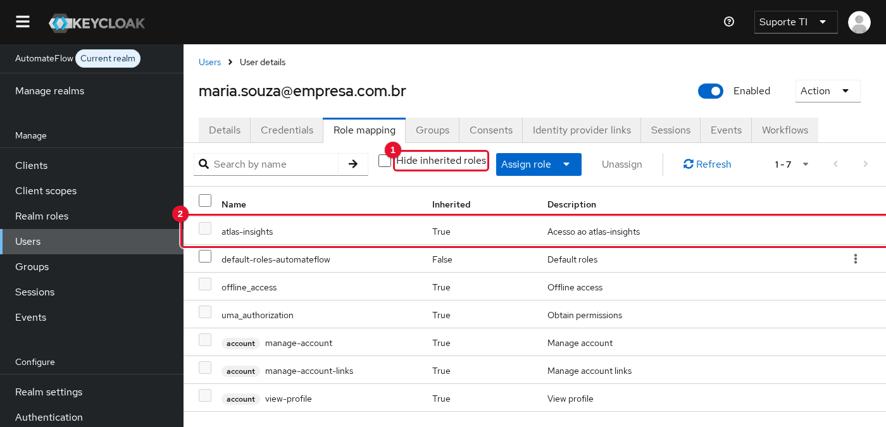

### 3.4 Grupos no token (opcional)

Os apps de hoje não precisam disso. Se algum app futuro quiser ler os grupos no token:

1. Em **Client scopes → Create client scope**, crie o scope `groups` (tipo *Default*).
2. Em **Mappers → By configuration → Group Membership**, use *Token Claim Name* `groups`, *Full group path* `Off` e *Add to access token* `On`.
3. Adicione o scope ao client em **Clients → \<client\> → Client scopes → Add client scope**.

---

## 4. Como configurar os grupos no SSO

O Keycloak só sabe dos grupos que o SSO manda **dentro da asserção SAML**. São quatro etapas:

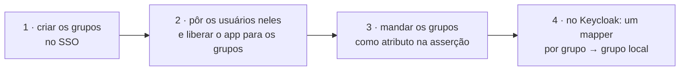

### 4.1 Recomendações para os grupos no SSO

| Faça | Evite |
|---|---|
| **Um grupo por perfil de acesso**, com prefixo do sistema: `automateflow-admins`, `automateflow-atlas`, `automateflow-linode`, `automateflow-migrator` | reaproveitar grupos genéricos (`TI`, `Todos`, `Financeiro`): quem entrar neles por outro motivo ganha acesso sem querer |
| **Grupos de segurança** (Entra: *Security group*; Google: grupo próprio do app) | listas de e-mail ou grupos de equipe |
| **Liberar o app só para esses grupos** (Entra: *Users and groups* + *Assignment required = Yes*; Google: *User access*). Quem está fora nem chega ao Keycloak | deixar o app liberado para todos |
| **Mandar só os grupos do app** na asserção | mandar todos os grupos do usuário: asserção enorme e o limite de 150 grupos do Entra |
| **Um dono por grupo**, que aprova as entradas. Entrar e sair do grupo no SSO é o único processo de concessão e revogação | dar acesso direto no Keycloak |

### 4.2 Passo a passo no Microsoft Entra ID (Azure)

> As figuras desta seção são **ilustrações** do portal do Azure, refeitas a partir dos campos do Entra ID (não são capturas de tela). O portal muda de layout com frequência, mas os nomes dos campos são estes. O app do exemplo se chama `AutomateFlow Keycloak`; é o *Enterprise application* criado na [seção 2.2](#22-criar-a-aplicação-saml-no-sso).

#### a) Criar um grupo de segurança por perfil

Em **Microsoft Entra ID → Groups → All groups → New group**:

1. **Group type**: `Security`.
2. **Group name**: o nome do perfil, com o prefixo `automateflow-`. Ele precisa ser **idêntico** ao **Value** do mapper no Keycloak (seção 4.4).
3. **Membership type**: `Assigned` (membros adicionados à mão) ou `Dynamic User`, se o acesso puder seguir uma regra, como departamento.
4. **Owners**: quem aprova as entradas no grupo.
5. **Members**: os usuários que terão o acesso.
6. **Create**.

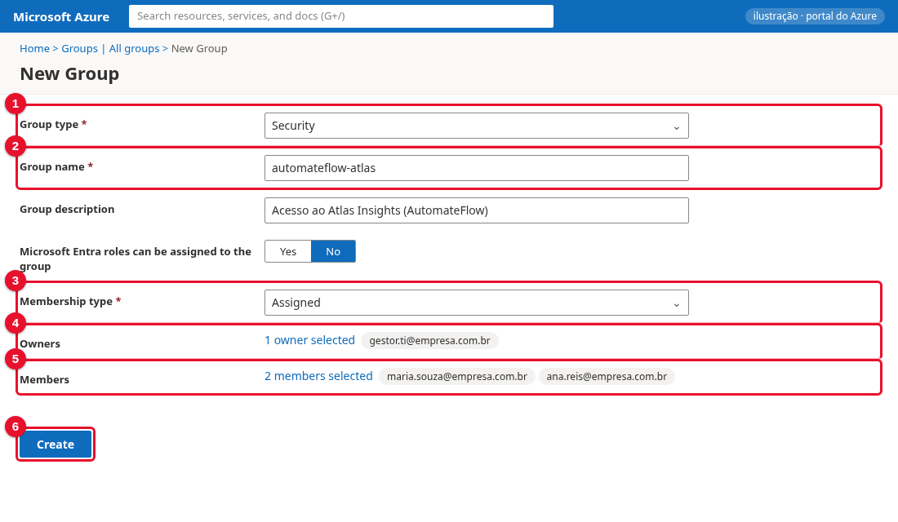

Repita para `automateflow-admins`, `automateflow-atlas`, `automateflow-linode` e `automateflow-migrator`.

#### b) Liberar o app para esses grupos

No app, em **Enterprise applications → AutomateFlow Keycloak → Users and groups**:

1. **Add user/group**: selecione os grupos `automateflow-*`, deixe a role `User` e clique em **Assign**.
2. A lista final deve ter só os grupos do AutomateFlow, um por linha.

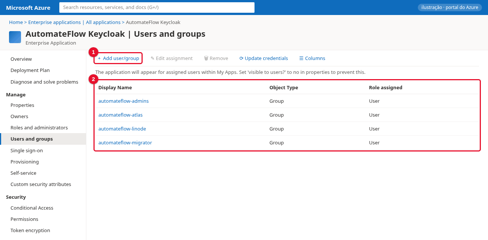

> A atribuição de **grupos**, e não de usuários, a um app exige licença **Microsoft Entra ID P1 ou P2**. Sem ela, o portal só deixa atribuir usuários um a um.

Em seguida, em **Properties**:

1. **Assignment required?**: `Yes`. Sem isso, **qualquer usuário do tenant** consegue entrar no Keycloak, e só o `KEYCLOAK_REQUIRED_ROLE` o barraria depois.
2. **Visible to users?**: `Yes` para o app aparecer no *My Apps*, `No` para escondê-lo.
3. **Save**.

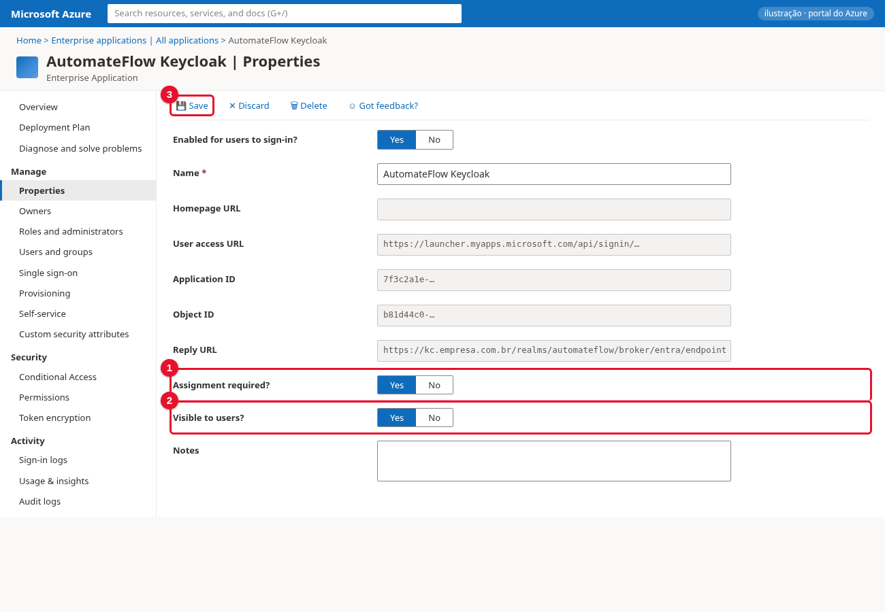

#### c) Mandar os grupos na asserção SAML

Em **Single sign-on → Attributes & Claims → Edit**:

1. **Add a group claim**.
2. Os *Additional claims* que já vêm por padrão (e-mail, nome, sobrenome) são os que os mappers da [seção 2.4](#24-mappers-de-atributos) leem.
3. Depois de salvar, aparece a linha do claim de grupos, com o valor `user.groups [ApplicationGroup]`.

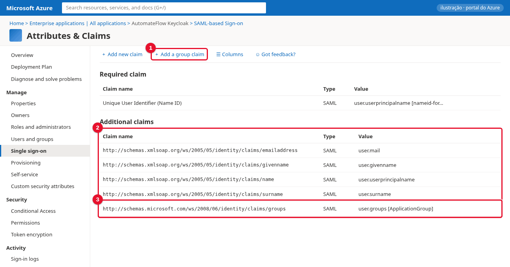

Na janela **Group Claims**:

1. **Groups assigned to the application**: manda só os grupos atribuídos ao app no passo b, nunca todos os grupos do usuário. Isso evita mandar `TI`, `Todos` etc. e o limite de 150 grupos por asserção.
2. **Source attribute**: o que vai em cada valor do claim (veja a próxima figura).
3. **Customize the name of the group claim**: marque e use **Name** `groups`, com **Namespace** vazio. O atributo chega como `groups` em vez de `http://schemas.microsoft.com/ws/2008/06/identity/claims/groups`, e o **Key** do mapper fica curto.
4. **Emit groups as role claims**: deixe **desmarcado**. Quem transforma grupo em role é o Keycloak.
5. **Save**.

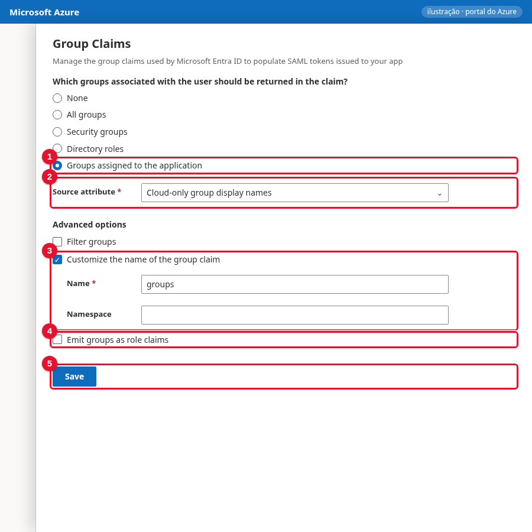

O **Source attribute** define o texto que chega em cada `<AttributeValue>`:

1. **Group ID**: o GUID do grupo (ex.: `3f1c9b0e-…`). É estável mesmo se o grupo for renomeado, mas no mapper você precisa colar o GUID.
2. **sAMAccountName**: o nome do grupo no AD local. Só funciona com grupos **sincronizados** do AD (Entra Connect).
3. **Cloud-only group display names**: o nome do grupo criado no Entra (ex.: `automateflow-atlas`). **Recomendado** quando os grupos são criados direto no Entra, como no passo a.

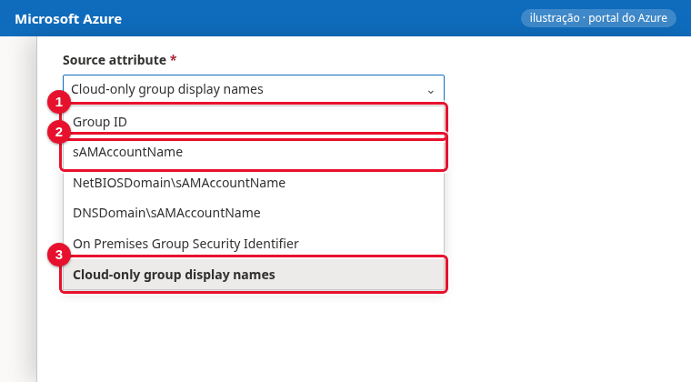

| Source attribute | Chega na asserção | **Value** no mapper do Keycloak |
|---|---|---|
| Cloud-only group display names | `automateflow-atlas` | `automateflow-atlas` |
| sAMAccountName (AD sincronizado) | `automateflow-atlas` | `automateflow-atlas` |
| Group ID | `3f1c9b0e-5a7d-4c1e-9f0a-…` | o *Object ID* do grupo (em *Groups → \<grupo\> → Overview*) |

### 4.3 Outros SSOs

**Google Workspace**: *SAML app → SAML attribute mapping → Group membership (optional)*.

- Em *Google groups*, selecione os grupos `automateflow-*`. Em *App attribute*, coloque `groups`.

**Okta**: em *SAML Settings → Group Attribute Statements*, use Name `groups` e Filter `Starts with` `automateflow-`.

### O que deve chegar ao Keycloak

O resultado esperado é uma asserção com um `<Attribute>` de grupos que tem **um `<AttributeValue>` por grupo**. Este é o trecho real da asserção que a usuária de teste recebeu do SSO simulado (o grupo `TI` veio junto, mas não tem mapper e por isso foi ignorado):

```xml
<saml:Subject>
  <saml:NameID Format="urn:oasis:names:tc:SAML:1.1:nameid-format:emailAddress">maria.souza@empresa.com.br</saml:NameID>
</saml:Subject>
<saml:AttributeStatement>
  <saml:Attribute Name="email">
    <saml:AttributeValue>maria.souza@empresa.com.br</saml:AttributeValue>
  </saml:Attribute>
  <saml:Attribute Name="firstName"><saml:AttributeValue>Maria</saml:AttributeValue></saml:Attribute>
  <saml:Attribute Name="lastName"><saml:AttributeValue>Souza</saml:AttributeValue></saml:Attribute>
  <saml:Attribute Name="groups"><saml:AttributeValue>TI</saml:AttributeValue></saml:Attribute>
  <saml:Attribute Name="groups"><saml:AttributeValue>automateflow-atlas</saml:AttributeValue></saml:Attribute>
</saml:AttributeStatement>
```

No Entra, o `Name` do atributo de grupos é o URI longo, e os de e-mail e nome seguem a tabela da [seção 2.4](#24-mappers-de-atributos).

### 4.4 Mapeando no Keycloak

Em **Identity providers → \<alias\> → Mappers → Add mapper**, crie **um mapper por grupo**:

1. **Sync mode override**: `Force`. Se o usuário sair do grupo no SSO, ele sai do grupo no Keycloak no próximo login.
2. **Mapper type**: `Advanced Attribute to Group`.
3. **Attributes**: em **Key**, o nome do atributo de grupos: `groups` no Google, no Okta e no Entra com o nome customizado (figura 46, item 3). Sem a customização, o Entra usa `http://schemas.microsoft.com/ws/2008/06/identity/claims/groups`. Em **Value**, o nome do grupo no SSO, ou o GUID se o Entra mandar *Group ID* (tabela da seção 4.2).
4. **Group**: em **Select group**, o grupo do Keycloak.

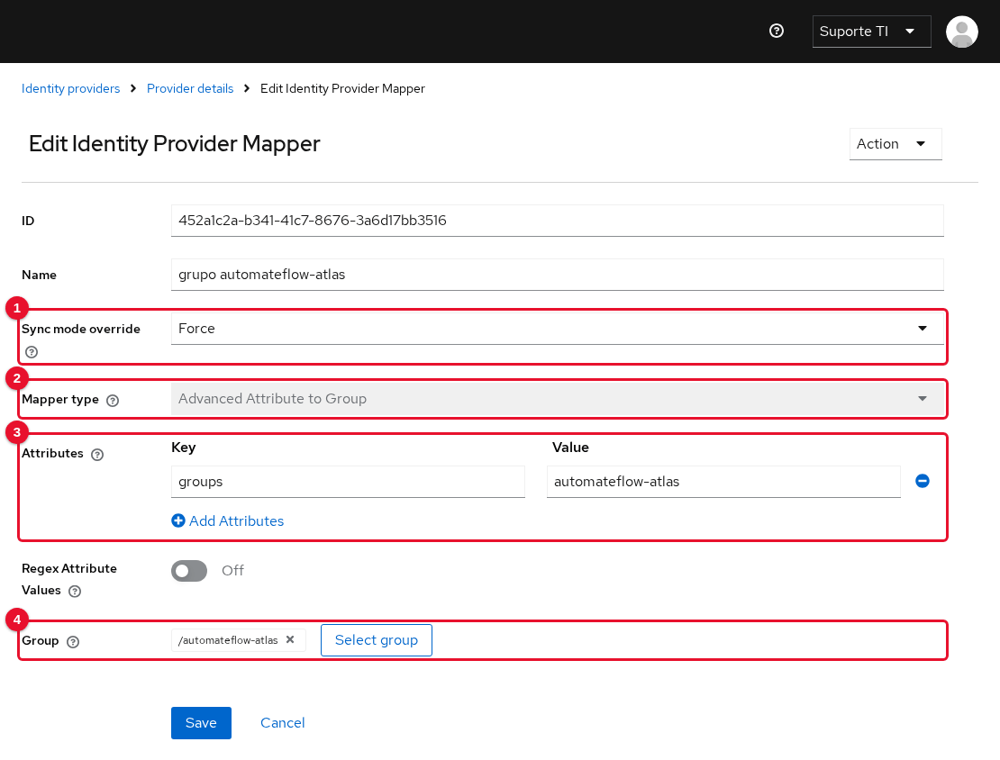

Repita para `automateflow-admins`, `automateflow-linode` e `automateflow-migrator`. A lista de mappers fica como na [figura da seção 2.4](#24-mappers-de-atributos).

> **Alternativa:** o mapper `SAML Attribute to Role` mapeia o valor direto para uma role, sem grupo no Keycloak. Funciona, mas a permissão fica escondida dentro do mapper. Prefira os grupos.

### 4.5 Conferindo

1. Coloque um usuário de teste em `automateflow-atlas` no SSO e faça login.
2. No Keycloak, em **Users → \<usuário\> → Groups** (1), ele deve aparecer só nos grupos mapeados (2). O `TI` da asserção não aparece:

   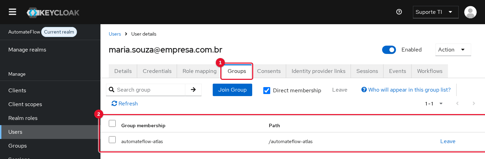

3. Em **Role mapping**, com *Hide inherited roles* desmarcado, deve aparecer a role `atlas-insights` (figura da [seção 3.3](#33-conferindo-as-roles-de-um-usuário)).
4. Tire o usuário do grupo no SSO, faça logout e login de novo. Ele deve sair do grupo no Keycloak e ser barrado pelo `KEYCLOAK_REQUIRED_ROLE`. No teste, trocar `automateflow-atlas` por `automateflow-linode` no SSO mudou o grupo no Keycloak já no login seguinte.
5. Se o grupo não aparecer, veja o que o SSO está mandando: ligue `KC_LOG_LEVEL=debug` ou use a extensão *SAML-tracer* do navegador, e confira o `Name` e os valores do atributo na asserção. Eles precisam bater **exatamente** (maiúsculas inclusive) com o **Key**/**Value** do mapper.

---

## Versionando o que foi feito no console

Tudo o que foi feito pelo console (provedor SAML, mappers, grupos, roles) fica só no banco. Para levar para o Git:

```bash
make realm-export   # grava o realm em ./export/
```

Ou use o botão **JSON para versionar** da tela **5 · Conferir** do assistente: ele já sai só com os blocos abaixo, sem ids, usuários, secrets nem chaves.

Copie de `export/<realm>-realm.json` para `realm/` só os blocos `identityProviders`, `identityProviderMappers`, `groups` e `roles`. **Não versione** usuários, hashes de senha nem a seção `components`, que tem as chaves privadas. Lembre-se de que o `realm/*.json` só é importado quando o realm ainda não existe (veja o [README](README.md#realm-automateflow)).
